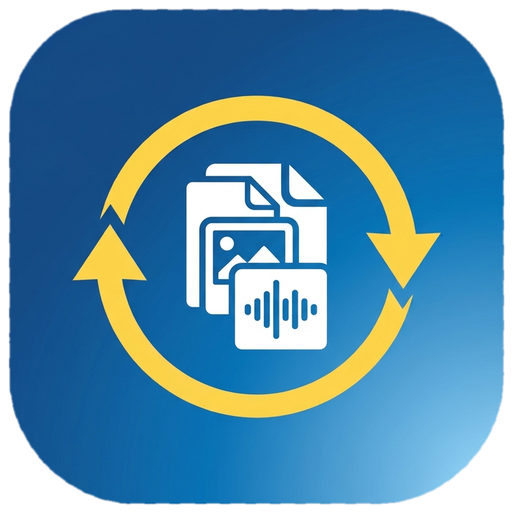

<p align="center"></p>

# Meu Conversor Pessoal

Aplicativo de desktop para Windows que converte e edita documentos, feito em Python com Tkinter.
Nasceu para ajudar minha tia, professora, que sempre precisava transformar PDFs em Word, e foi crescendo
junto com o que fui aprendendo.

## O que ele faz

| Opção | Descrição |
|---|---|
| **PDF para Word** | Converte PDFs com texto em documentos `.docx` editáveis |
| **PDF para Texto** | Extrai o texto de um PDF e salva em `.txt` |
| **Word para PDF** | Converte `.docx` em PDF (precisa do Microsoft Word instalado) |
| **PDF de partitura** | Editor de acordes para partituras em PDF |

### Editor de acordes

Pensado para partituras e cifras em PDF, onde a conversão para Word não funciona (a música é
desenhada com fontes especiais). O editor mantém a partitura idêntica e permite mexer só nos acordes:

- Adicionar, editar, mover e apagar acordes com o mouse.
- Reconhece os acordes que já existem no PDF (`C`, `F#m7`, `Bb/D`...) pelo formato do texto.
- Alinha os acordes novos acima da pauta, na mesma altura dos originais, e aprende o tamanho da letra do PDF.
- Paleta com os acordes do tom escolhido (teclas `1` a `8`) e transposição de todos os acordes.
- Menu de fonte, zoom, desfazer/refazer e atalhos de teclado.
- Salva o projeto (`.acordes.json`) para continuar editando depois e exporta o PDF final.

**Limitação:** o alinhamento automático funciona em PDFs com pauta vetorial (exportados de programas
como Sibelius, MuseScore e Finale). Em PDFs escaneados (foto), os acordes ficam onde você clicar.

## Baixar e usar (sem instalar nada)

Vá na aba **[Releases](../../releases)** e baixe o `.exe` da versão mais recente.

> O Windows pode mostrar um aviso do SmartScreen, porque o programa não é assinado digitalmente.
> Clique em **Mais informações → Executar assim mesmo**.

## Rodar pelo código

```bash
python -m venv venv
venv\Scripts\activate
python -m pip install -r requirements.txt
python app.py
```

## Gerar o .exe

```bash
python -m PyInstaller --clean --onefile --windowed --icon=assets\icone.ico --add-data "assets;assets" --name MeuConversorPessoal app.py
```
O arquivo aparece na pasta `dist`.

## Estrutura do projeto

```
app.py                  janela principal e menu
assets/                 ícone e logo
conversores/
    pdf_word.py         PDF <-> Word (sem janelas)
    pdf_text.py         PDF -> texto
partitura/
    logica.py           regras do editor: ler acordes, achar pautas, transpor, projeto
    janela.py           tela do editor: botões, mouse, teclado
tests/
    test_logica.py      testes automáticos da lógica
```

A lógica não depende de janelas, por isso pode ser testada sozinha e reaproveitada em outros programas.

## Testes

```bash
python -m pip install pytest
python -m pytest
```

## Tecnologias

Python · Tkinter · PyMuPDF · pdf2docx · docx2pdf · PyInstaller · pytest

## Autor

Davi Angelo · [GitHub](https://github.com/Davi700466)